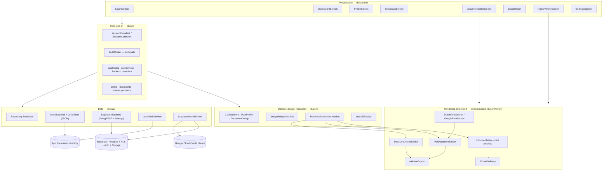
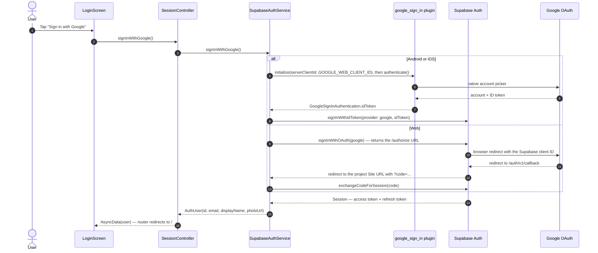
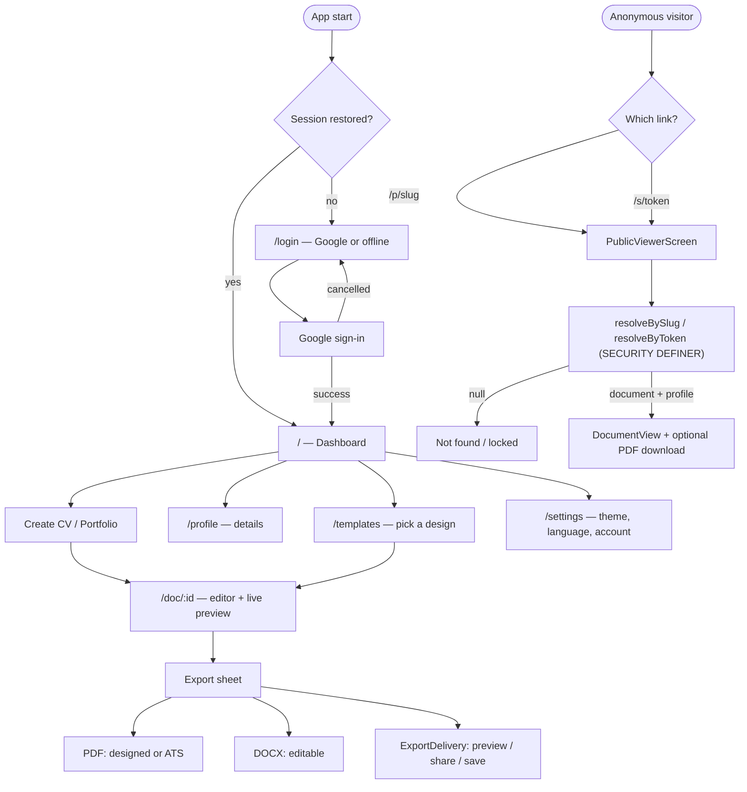

# Project Architecture — CV & Portfolio Studio

> **Status of this document.** Everything below was derived by reading the source
> in this repository at the commit that contains these files. Where a fact could
> not be verified from the code (a live Supabase project, a deployed migration,
> real Google credentials) it is explicitly marked **unverified**. No credential
> values appear anywhere in this repository.

---

## 1. Project Overview

### Purpose

One reusable professional profile, rendered as many documents. The app keeps the
user's career data (`UserProfile`) separate from each document's presentation
(`CvDocument` + `DocumentDesign`), so the same profile can drive a one-column ATS
CV, a two-column designed CV and a gallery-style portfolio without duplicating
content.

### Supported platforms

| Platform | Folder | Status |
| --- | --- | --- |
| Android | `android/` | Generated and built in CI here (`flutter build apk --debug` succeeds) |
| Web | `web/` | Generated; builds with `flutter build web` |
| Windows | `windows/` | Generated; Google sign-in is **not** available on it (see §12) |
| iOS / macOS / Linux | *absent* | No `ios/`, `macos/` or `linux/` folder exists in this checkout |

`.metadata` lists exactly `root`, `android`, `web` and `windows` as created
platforms, which is why the iOS parts of the configuration model exist in Dart
but have no platform folder behind them.

### Main features (all visible in the code)

- **Sign in** with Google (Supabase-backed) or continue offline with a local
  identity (`LocalAuthService`).
- **Dashboard**: list/create/delete CV and portfolio documents, profile
  completion percentage.
- **Profile editor**: name, professional title, email, phone, location, website,
  summary and a list of links.
- **Document editor**: layout mode (one/two/mix), add/remove/reorder/rename/hide
  sections, per-section field visibility, per-entry ordering and hidden entries,
  colour, typography, spacing, page and presentation controls, plus a live
  preview. Seven built-in templates.
- **Export**: designed PDF, ATS-friendly PDF, editable DOCX (OOXML), with
  validation findings and localised delivery feedback.
- **Public viewer**: renders a published document from a slug or a restricted
  token without a session.
- **Settings**: theme (system/light/dark), language (English/Arabic with RTL),
  sign out, delete account.
- **Offline-first fallback**: with no Supabase credentials the whole product runs
  against a local JSON store.

### Technology stack (installed versions)

Environment measured in this workspace: **Flutter 3.47.7 (stable), Dart 3.13.5**.
`pubspec.yaml` requires `sdk: ^3.13.5`.

| Package | Version | Why it matters architecturally |
| --- | --- | --- |
| `flutter_riverpod` | ^3.4.3 | All state and dependency injection |
| `go_router` | ^18.0.2 | Declarative routing + auth gate |
| `supabase_flutter` | ^2.18.2 | Auth, Postgres, Storage client (`supabase` 2.16.4, `gotrue` 2.27.3) |
| `google_sign_in` | ^7.2.0 | Native Google identity (`google_sign_in_android` 7.2.17, `google_sign_in_ios` 6.3.6, `google_sign_in_web` 1.1.3) |
| `app_links` | transitive (7.2.2) | Deep-link stream used by `supabase_flutter` for OAuth callbacks |
| `pdf` | ^3.13.1 | PDF document model |
| `printing` | ^5.15.1 | Platform preview/share of PDFs |
| `archive` | ^4.3.0 | ZIP container for the DOCX writer (also used by tests) |
| `bidi` | ^2.0.13 | Unicode Bidi Algorithm, shared by the renderer and exporters |
| `file_picker` | ^13.1.0 | System document picker used to save a DOCX with the correct media type |
| `path_provider` | ^2.1.6 | Local store root directory |
| `shared_preferences` | ^2.5.6 | Session persistence keys, locale/theme |
| `uuid` | ^4.6.0 | Entry/document identifiers |
| `video_player`, `url_launcher`, `intl` | declared | **Not referenced anywhere in `lib/`** — see §12 |

### Backend services

| Service | Responsibility | Where it is configured |
| --- | --- | --- |
| Supabase Auth | Google OAuth, session issue/refresh, JWT | Supabase dashboard + `--dart-define` values |
| Supabase Postgres | `profiles`, `documents`, `document_shares` | `supabase/migrations/*.sql` |
| Row Level Security | Ownership and anonymity boundary | Same migrations |
| Postgres functions | Share resolution, view counting, account deletion | `0002_sharing_functions.sql` |
| Supabase Storage | Private `document-media` bucket | `0003_storage.sql` |
| Google Cloud | OAuth clients for web/Android | Google Cloud console (outside the repo) |

The Flutter client only ever holds the **publishable** key. The service-role key
and the Google client secret belong to the dashboard and are never read by the
app (asserted by a test that the config's `toString()` cannot leak them).

---

## 2. Architecture Overview

### Pattern

A **layered, feature-first architecture with an explicit domain/resolution core
and a swappable persistence backend**, wired by Riverpod. There is no code
generation, no BLoC, and no service locator: dependencies are interfaces
(`abstract interface class`) implemented once per backend and injected through
`ProviderScope` overrides at startup.

Two design decisions dominate the codebase:

1. **Backend swap by interface.** `lib/data/repositories.dart` declares
   `ProfileRepository`, `DocumentRepository`, `ShareRepository`,
   `MediaRepository` and `AccountRepository`. `LocalBackend` (JSON files) and
   `SupabaseBackend` (PostgREST/Storage) implement all five. UI code only ever
   sees these interfaces through `LocalBackendOrSupabase`.
2. **One resolution step for every renderer.** `ResolvedDocument.resolve()`
   turns `CvDocument` + `UserProfile` into a flat, presentation-agnostic
   structure (ordered, visibility-filtered sections, filtered contact lines,
   resolved titles). The on-screen preview, the public page, the PDF builder and
   the DOCX builder all consume it, so visibility/order/ATS rules exist in one
   place.

### Layers

| Layer | Location | Responsibility | May depend on |
| --- | --- | --- | --- |
| Presentation | `lib/features/**` | Screens, forms, previews, dialogs | `lib/app`, `lib/core`, repository interfaces |
| State / DI | `lib/app/**` | Providers, session controller, router, backend selection | `lib/core`, `lib/data` |
| Domain | `lib/core/domain/**` | Immutable models + JSON mapping + enums | nothing (pure Dart) |
| Design | `lib/core/design/**` | Template catalogue → `DocumentDesign` factories | domain |
| Resolution | `lib/core/render/**`, `lib/core/export/document_text.dart` | Ordering/visibility/ATS normalisation | domain |
| Rendering / export | `lib/core/export/**`, `lib/core/render/document_view.dart` | PDF, DOCX, fonts, delivery, on-screen view | resolution, domain |
| Data access | `lib/data/**` | Repository interfaces + local/Supabase implementations, auth services | domain |
| Local persistence | `lib/data/local/**` | JSON store under the app documents directory | – |
| Backend | Supabase project | Postgres + RLS + Auth + Storage | – |
| Platform config | `android/`, `web/`, `windows/` | Application id, manifest, queries | – |

### Dependency direction

`features → app → data → domain`, and `features → core (render/export) → domain`.
Nothing in `lib/core/domain` imports Flutter, Riverpod or Supabase, which is why
the domain and export layers are unit-testable without a binding. The data layer
imports the domain but never the UI. The one inversion is `app/providers.dart`:
it owns the concrete choice between `LocalBackend` and `SupabaseBackend`.

### Initialisation and lifecycle

`lib/main.dart` runs, in order:

1. `WidgetsFlutterBinding.ensureInitialized()`.
2. `AppConfig.fromEnvironment()` — reads the `--dart-define` values and picks
   `BackendMode.local` when `SUPABASE_URL`/`SUPABASE_ANON_KEY` are absent.
3. `Supabase.initialize(url:, publishableKey:)` — **only** when configured.
4. `createBackend(config)` — `SupabaseBackend` or `LocalBackend(LocalStore)`.
5. `createAuthService(config)` — `SupabaseAuthService` or `LocalAuthService`.
6. `runApp(ProviderScope(overrides: [appConfig, backend, authService], child: ...))`.

`_AppContent` then mirrors the session into a `ValueNotifier<bool>` that GoRouter
uses as `refreshListenable`, and builds `MaterialApp.router` with the theme and
locale from their providers. Session restoration happens inside the
`sessionProvider2` notifier's `build()`, so the router's first redirect already
sees the restored session. `LocalAuthService` reads its identity from
`SharedPreferences`, so a restart restores the same user offline.

### Architecture diagram



### Why the diagram is shaped this way

- The **presentation layer never touches Supabase types**. Screens read
  providers and call repository methods, so the same screen works in offline
  mode.
- **Rendering has two entry points** (`DocumentView` for pixels, the builders for
  files) but one source of truth (`ResolvedDocument`), which is what keeps the
  preview, the PDF and the DOCX visually consistent.
- **Delivery is separate from generation**: the exporters return bytes; only
  `ExportDelivery` talks to the platform.

---

## 3. Directory and File Structure

```
lib/
  main.dart                      entry point: config → Supabase → backend → app
  app/
    router.dart                  GoRouter: /login, /, /profile, /templates,
                                 /settings, /doc/:id, /p/:slug, /s/:token
    session.dart                 SessionController (sessionProvider2),
                                 LocaleController, ThemeModeController
    providers.dart               config/auth/backend providers, backend facade,
                                 profile/documents/shares family providers
  core/
    config/app_config.dart       credentials from --dart-define + backend mode
    domain/                      models only (no Flutter imports)
      document_entity.dart       CvDocument, DocumentShare (+ access/URL rules)
      document_models.dart       SectionConfig, DocumentDesign and its configs
      profile_models.dart        ProfileDetails + 12 entry types + UserProfile
      enums.dart                 all enumerations and their persisted keys
      enum_converters.dart       JSON converters for the enums
    design/
      templates.dart             template catalogue, default section order
      template_definitions.dart  the seven designs
    render/
      resolved_document.dart     resolve() + atsSafeDesign(): ordering,
                                 visibility and ATS rules for every renderer
      document_layout.dart       column partitioning for two/mix layouts
      document_view.dart         on-screen renderer (preview + public page)
      section_titles.dart        default EN/AR headings, proficiency, icons
    export/
      export_service.dart        DocumentExporter: validate/export/exportDocx
      pdf_builder.dart           page composition and pagination
      pdf_sections.dart          section renderers (LTR/RTL aware)
      pdf_style.dart             text styles, palette application
      export_fonts.dart          font resolution (bundled → download → base-14)
      base_font_text.dart        transliteration of glyphs base-14 cannot draw
      arabic_text.dart           shaping + bidi helpers
      document_text.dart         flattenDocument() used by validation
      docx_builder.dart          OOXML (WordprocessingML) package writer
      export_validation.dart     validateExport(): error/warning/info codes
      export_delivery.dart       preview / share / saveDocument + DOCX media type
      image_bytes*.dart          per-platform image fetch (io loader / web stub)
    l10n/                        app_strings.dart, strings_en.dart, strings_ar.dart
    theme/                       app_theme.dart, app_tokens.dart
    utils/utils.dart             ids, slugs, share tokens, URL safety, limits
  data/
    repositories.dart            the five repository interfaces + exceptions
    auth/auth_service.dart       AuthUser/AuthService/AuthException + factory
    auth/local_auth_service.dart offline identity (SharedPreferences)
    auth/supabase_auth_service.dart Google → Supabase session
    local/local_store.dart       JSON file store under the documents directory
    local/local_repositories.dart LocalBackend (all five interfaces)
    supabase/supabase_backend.dart SupabaseBackend + Tables/Buckets constants
  features/
    auth/login_screen.dart       Google + offline sign-in
    dashboard/dashboard_screen.dart documents list, create/delete, completion
    profile/profile_screen.dart  professional details form
    templates/templates_screen.dart template picker
    editor/document_editor_screen.dart layout/section/design controls + preview
    export/export_sheet.dart     validation findings + export buttons
    viewer/public_viewer_screen.dart anonymous viewer (slug/token)
    settings/settings_screen.dart theme, language, account
assets/google_fonts/             bundled Noto Naskh Arabic + OFL licence + README
supabase/migrations/             0001_init.sql, 0002_sharing_functions.sql,
                                 0003_storage.sql (must be applied to a project)
test/                            unit + rendering tests (see section 11)
tools/inspect_pdf.py             renders a PDF to PNGs for visual QA
tools/validate_docx.py           independent OOXML validator (CPython zipfile/XML)
android/ web/ windows/           platform folders (no ios/, macos/ or linux/)
```

### Entry points and feature boundaries

| Entry point | File | Notes |
| --- | --- | --- |
| Process start | `lib/main.dart` | The only place that constructs the backend |
| Route table | `lib/app/router.dart` | The only place that decides who may see a route |
| Backend choice | `lib/app/providers.dart` (`createBackend`) | Single switch between local and Supabase |
| Auth choice | `lib/data/auth/auth_service.dart` (`createAuthService`) | Single switch between offline and Google |
| Rendering | `lib/core/render/resolved_document.dart` | Every renderer starts here |
| Export | `lib/core/export/export_service.dart` | Generates bytes; never touches the platform |

Each `lib/features/*` folder is one screen (or one sheet) plus its private
widgets; features never import each other.

### Files that should not be modified casually

| File | Why |
| --- | --- |
| `lib/core/domain/**` | Defines the JSON contract already stored in Supabase and in local files. A rename breaks existing rows; prefer additive fields. |
| `lib/data/repositories.dart` | Contract implemented twice; changing it changes both backends and every screen. |
| `supabase/migrations/000*.sql` | Applied state on a live project is unknown to the repo. Add a new numbered migration instead of editing an old one. |
| `lib/core/render/resolved_document.dart` | Ordering, visibility and ATS decisions for every output (screen, PDF, DOCX). |
| `lib/core/export/pdf_sections.dart`, `pdf_style.dart`, `document_view.dart` | Must stay aligned; RTL and base-font handling were verified visually, not only by tests. |
| `android/app/build.gradle.kts` (`applicationId`) | Must keep matching the Android OAuth client registered in Google Cloud. |
| `android/app/src/main/java/io/flutter/plugins/GeneratedPluginRegistrant.java` | Generated by the Flutter tool; edits are overwritten on the next build. |

---

## 4. Authentication and Google OAuth

### The actual login sequence

The button in `lib/features/auth/login_screen.dart` calls:

```dart
ref.read(sessionProvider2.notifier).signInWithGoogle()
```

which is `SessionController.signInWithGoogle()` in `lib/app/session.dart`. It sets
`AsyncLoading`, awaits `authServiceProvider.signInWithGoogle()`, then stores the
result as `AsyncData(user)`. A *cancelled* sign-in is special-cased: instead of
showing an error it restores the previous session and stays on the login screen.
Any other error becomes `AsyncError`, and the screen shows `errorGeneric`.

`authServiceProvider` was overridden at startup by `createAuthService(config)`
(`lib/data/auth/auth_service.dart`):

- Supabase configured → `SupabaseAuthService` (Google, real backend).
- Nothing configured → `LocalAuthService`, where `signInWithGoogle()` simply
  creates a local identity, so the "Sign in with Google" button still works
  offline. This is deliberate: the whole product stays explorable with no
  credentials.

`SupabaseAuthService.signInWithGoogle()` branches once:

```dart
if (kIsWeb) return _signInWeb();
return _signInNative();
```

### Which mechanism is used (verified from the packages in this repo)

| Platform | Mechanism | Identity handed to Supabase |
| --- | --- | --- |
| Android | `google_sign_in` 7.2.0 (Credential Manager / Google Identity) | OIDC **ID token** via `signInWithIdToken` |
| Web | Supabase `signInWithOAuth(OAuthProvider.google)` — the native plugin is not used | PKCE authorization **code** exchanged by gotrue |
| iOS/macOS | `google_sign_in` (same code path as Android) | ID token — **no `ios/` folder exists yet**, so this is untested |
| Windows/Linux | Not supported by the plugin; the app now says so explicitly | – |

`signInWithOAuth` is supplied by `supabase_flutter` as an extension on
`GoTrueClient` (`supabase_flutter-2.18.2/lib/src/supabase_auth.dart`). With no
`redirectTo` argument, gotrue builds:

```
https://<project-ref>.supabase.co/auth/v1/authorize
    ?provider=google
    &flow_type=pkce
    &code_challenge=...
    &code_challenge_method=s256
```

and, on Android only, forces `LaunchMode.externalApplication`. The default flow
type in gotrue 2.27.3 is `AuthFlowType.pkce`, and the callback is exchanged with
`exchangeCodeForSession(code)`. **No `redirect_to` parameter is sent**, because
the app passes no `redirectTo` — Supabase therefore falls back to the project's
configured **Site URL** (see §10 and `GOOGLE_OAUTH_SETUP.md`).

### Sequence diagram



### Configuration map

| Setting | Exact location in this project | Purpose | Required value / type | Where to obtain it |
| --- | --- | --- | --- | --- |
| Supabase project URL | `--dart-define=SUPABASE_URL` → `AppConfig.supabaseUrl` (`lib/core/config/app_config.dart`), consumed at `lib/main.dart:21` | Backend endpoint | `https://<project-ref>.supabase.co` | Supabase Dashboard → Project Settings → API → Project URL |
| Supabase publishable / anon key | `--dart-define=SUPABASE_ANON_KEY` → `AppConfig.supabaseAnonKey`, passed as `publishableKey:` to `Supabase.initialize` | Client API access | public client key | Dashboard → Project Settings → API keys |
| Google **Web** Client ID | `--dart-define=GOOGLE_WEB_CLIENT_ID` → `AppConfig.googleWebClientId`; passed to `GoogleSignIn.instance.initialize(serverClientId:)` and reused by the Supabase Google provider | OAuth identity | Web application client ID | Google Cloud → APIs & Services → Credentials |
| Google Client Secret | **Not in this repository.** Supabase Dashboard → Authentication → Providers → Google → *Client Secret* | Provider verification | secret string | Google Cloud → the same Web client |
| Android OAuth client | Not in Dart. Registered against `applicationId = "com.mtfooda.cv_portfolio_maker"` (`android/app/build.gradle.kts:19`) | Android app identity; required by Credential Manager | Android OAuth client ID + SHA-1 | Google Cloud → Credentials → Create OAuth client → Android |
| Redirect / callback URL | Not in code: the app sends **no** `redirect_to`, so Supabase uses its configured **Site URL**. Google-side callback: `https://<project-ref>.supabase.co/auth/v1/callback` | Return from OAuth | exact URI(s) | Supabase → Authentication → URL Configuration; Google Cloud → Web client redirect URIs |
| Android SHA-1 / SHA-256 | `android/app/build.gradle.kts:32-38` signs **every** build type with the debug keystore | Identify the Android app | SHA-1 (optionally SHA-256) | `./gradlew signingReport` or `keytool -list -v` |
| iOS client and URL scheme | `--dart-define=GOOGLE_IOS_CLIENT_ID` → `initialize(clientId:)`; would also need `CFBundleURLSchemes` in `ios/Runner/Info.plist` | iOS callback | iOS client ID + reversed-client-id scheme | Google Cloud → iOS OAuth client. **No `ios/` folder exists, so this is inactive** |

### Redirect URLs, deep links and platform settings

Derived from the implementation, not assumed:

1. **Android uses no redirect at all.** The native flow is ID token →
   `signInWithIdToken`, so there is no browser, no custom URL scheme, no
   `intent-filter` for a scheme, and no `google-services.json`: the file does not
   exist anywhere under `android/app/` (the project deliberately does not use the
   Gradle google-services plugin, so the client ID is passed from Dart instead).
   Confirmed by reading `android/app/src/main/AndroidManifest.xml` (only
   `MAIN`/`LAUNCHER`, plus a `CREATE_DOCUMENT` query).
2. **Web** completes through the browser:
   - the app is served from some origin, for example `http://localhost:8080`;
   - `signInWithOAuth` returns an
     `https://<project-ref>.supabase.co/auth/v1/authorize?...` URL which is
     opened in the same tab (`webOnlyWindowName: '_self'`);
   - Google returns the browser to `/auth/v1/callback` on the Supabase project;
   - Supabase redirects to `redirect_to`, or — because this app omits it — to the
     project's **Site URL**, appending `?code=...`;
   - gotrue inside the app sees the `code` and calls `exchangeCodeForSession`, so
     the session arrives asynchronously; `_awaitSession()` waits for exactly that
     event, with a 120 s timeout.
3. **Two lists must hold the right URLs and only one of them is in the app's
   control:**
   - Supabase → Authentication → **URL Configuration**: `Site URL` (the default
     return target) and `Redirect URLs` (every origin you use, e.g.
     `http://localhost:8080/**` and the production origin).
   - Google Cloud → the **Web** client → Authorized redirect URIs:
     `https://<project-ref>.supabase.co/auth/v1/callback` (Supabase shows this
     value verbatim in the Google provider panel).
   Neither value could be read from here — no live project or credentials were
   available. Copy them from those two screens instead of inventing them.
4. **Deep links** are handled by `supabase_flutter` (`SupabaseAuth` +
   `app_links`, `detectSessionInUri` defaults to `true`) for platforms that
   redirect into the app. On web that machinery is deliberately skipped —
   `supabase_auth.dart` notes the browser owns the callback — and since Android
   does not redirect either, **no deep-link configuration is required today**.
5. **Android package visibility** (unrelated to auth, but it is the other
   platform switch in the manifest): the DOCX export adds a `<queries>` entry for
   `ACTION_CREATE_DOCUMENT` because Android 11+ would otherwise hide the document
   picker from `Intent.resolveActivity`.

### Session lifecycle, logout and error handling

| Concern | Implementation | File |
| --- | --- | --- |
| Restore on start | `SessionController.build()` → `restoreSession()` → `auth.currentSession` | `lib/app/session.dart`, `lib/data/auth/supabase_auth_service.dart` |
| Persistence | `supabase_flutter` stores the session in SharedPreferences and refreshes tokens; `SupabaseAuth` starts/stops auto-refresh from the app lifecycle | package internals |
| Cancelled sign-in | `GoogleSignInException` → `AuthException(cancelled: true)`; the controller silently restores the previous session instead of showing an error | `supabase_auth_service.dart`, `session.dart` |
| Missing client ID | `AuthException('Google sign-in is not configured: GOOGLE_WEB_CLIENT_ID is empty. …')` — **added during this audit** | `supabase_auth_service.dart` |
| Unsupported platform | `AuthException('Google sign-in is not supported on this platform …')` on Windows/Linux — **added during this audit** | `supabase_auth_service.dart` |
| Web timeout | No session within 120 s → reports "Google sign-in was cancelled" | `supabase_auth_service.dart` |
| Logout | `GoogleSignIn.instance.signOut()` (errors ignored when the plugin was never initialised) then `auth.signOut()`; the controller invalidates `profileProvider`, `documentsProvider`, `sharesProvider` and sets `AsyncData(null)`, so the router returns to `/login` | `supabase_auth_service.dart`, `session.dart` |
| Route protection | `redirect` sends anonymous users to `/login`, except `/login`, `/p/:slug` and `/s/:token` | `lib/app/router.dart` |

Two code-level observations that affect behaviour:

- The **user-visible** message for a failed sign-in is always `errorGeneric`; the
  login screen never renders `AuthException.message`. The detailed messages above
  are developer-facing (and asserted by tests).
- `sessionProvider2` is not subscribed to `onAuthStateChange`, and the streaming
  providers `authUserProvider` / `sessionProvider` in `lib/app/providers.dart`
  are defined but read by no screen. A session revoked server-side is therefore
  noticed only when a backend call fails, not by an automatic redirect to
  `/login`.
- `google_sign_in_android` documents that a **configuration** error can surface as
  `GoogleSignInExceptionCode.canceled`, which this app maps to "cancelled". A
  wrong SHA-1 or package name can therefore look like the user dismissing the
  account picker. See §13.

### Verified here versus unverified

| Statement | Status |
| --- | --- |
| Routing, session state, service selection, guards, config plumbing | **Verified** by reading the code and by 12 new tests in `test/auth_config_test.dart` |
| No secret is embedded in the repository; only `--dart-define` values are read | **Verified** from `AppConfig` and by a test asserting `toString()` cannot leak them |
| No `google-services.json`, no OAuth `<intent-filter>`, no iOS scheme | **Verified** by file inspection |
| Redirect target is the project's **Site URL** (no `redirect_to` is sent) | **Verified** from gotrue 2.27.3 source (`_getUrlForProvider`) |
| A real Google exchange (account picker, ID token, session, refresh) | **Not verified** — no credentials, no device/emulator, no live project |
| Whether the Google provider is enabled, the Site URL value, the registered SHA-1 | **Not verified** — dashboard state outside this repository |

---

## 5. Supabase Backend

### Client initialisation

`lib/main.dart` calls `Supabase.initialize(url:, publishableKey:)` only when both
`SUPABASE_URL` and `SUPABASE_ANON_KEY` are present. `supabase_flutter` 2.18.2
renamed the parameter: `publishableKey` is current and `anonKey` is deprecated but
still accepted — the app passes the dashboard's publishable/anon key through
`publishableKey`. `SupabaseBackend` then reads `Supabase.instance.client`.
Table and bucket names live in one place (`lib/data/supabase/supabase_backend.dart`):
`profiles`, `documents`, `document_shares`, and the `document-media` bucket.

### Migrations and execution order

`supabase/migrations/` must be applied **in filename order**. Nothing in this
repository applies them, and nothing verifies that they were applied — treat
"the SQL file exists" as *not* evidence that the schema is live.

| Order | File | What it creates |
| --- | --- | --- |
| 1 | `0001_init.sql` | `pgcrypto`; the three tables; indexes; RLS enabled with three policies |
| 2 | `0002_sharing_functions.sql` | `generate_share_token()`, `resolve_share_by_slug(text)`, `resolve_share_by_token(text)`, `record_share_view(uuid)`, `delete_own_account()`; grants and revokes |
| 3 | `0003_storage.sql` | the private bucket `document-media` and four `storage.objects` policies |

### Schema

**`profiles`** — one row per user, `id` referencing `auth.users(id)`
`on delete cascade`. All content is `jsonb` (`details`, `experiences`,
`education`, `skills`, `languages`, `certificates`, `courses`, `awards`,
`volunteer`, `publications`, `references`, `projects`, `custom_sections`) plus
`created_at`/`updated_at`. The JSON shape is owned by `UserProfile.fromJson` /
`toJson` in Dart, so the database itself is deliberately schema-light.

**`documents`** — `id`, `owner_id` → `auth.users` cascade, `title` (non-blank
check), `type` (`cv`|`portfolio`), `design` jsonb (a whole `DocumentDesign`),
`included_project_ids` text[], `share_mode`
(`privateDraft`|`publicLink`|`restrictedRecipient`), `published`, `public_slug`
(unique), `allow_pdf_download`, `is_rtl`, `version`, `created_at`/`updated_at`.
Indexes: `(owner_id, updated_at desc)` and a unique partial index on
`public_slug`.

**`document_shares`** — `document_id` cascade, `mode` (`publicLink` or
`restrictedRecipient`), `access_token` (unique), `slug` (unique),
`recipient_label`, `recipient_email`, `expires_at`, `revoked_at`, `view_count`,
`created_at`, plus a check constraint on the identifier shape: a public link
carries a slug and no token, a restricted share carries a token and no slug.

### Row Level Security — the real authorisation boundary

| Table | Policy | Rule |
| --- | --- | --- |
| `profiles` | `profiles are self-service` (ALL) | `auth.uid() = id` for both `using` and `with check` |
| `documents` | `owners manage their documents` (ALL) | `auth.uid() = owner_id` |
| `document_shares` | `owners manage their shares` (ALL) | the share's document is owned by `auth.uid()` (exists-subquery) |
| `storage.objects` | four policies (SELECT/INSERT/UPDATE/DELETE) | bucket is `document-media` **and** `(storage.foldername(name))[1] = auth.uid()::text` |

There is deliberately **no anonymous SELECT policy** on any table. Public reads
happen only through `SECURITY DEFINER` functions, which keeps a share scoped to
one document instead of exposing the owner's account. The Flutter client
additionally scopes its own queries with `.eq('owner_id', userId)` and refuses to
act without a session (`_requireUserId` throws `UnauthorizedException`).

### RPCs

| Function | Security | Caller in this app |
| --- | --- | --- |
| `resolve_share_by_slug(p_slug)` | `security definer`, `search_path = public` | `SupabaseBackend.resolveBySlug` |
| `resolve_share_by_token(p_token)` | same; delegates to slug resolution for the token's share | `resolveByToken` |
| `record_share_view(p_share_id)` | same; best-effort counter | `recordView` (failures ignored) |
| `delete_own_account()` | same; deletes the `auth.users` row, cascading to every table | `deleteAccount` |
| `generate_share_token()` | `security definer`; 32 random bytes, base64url | **Never called by the app** (see §12) |

`resolve_share_by_*` returns `null` when the share is missing, revoked, expired or
its document is unpublished, so the client cannot distinguish the reasons and
reports "not found" for all of them. The returned JSON holds the document and the
owner's profile — and also the document's `ownerId`, which is worth knowing if
you ever treat that id as private.

Grants are explicit: `revoke all … from public`, then `grant execute` to
`anon, authenticated` for the three resolvers/view counter, and to
`authenticated` only for `generate_share_token` and `delete_own_account`.

### Storage

One **private** bucket, `document-media`. Object names are
`<user-id>/<timestamp>_<file-name>` (Supabase) or `<user-id>/<safe-name>` (local)
— exactly the prefix the policies compare against `auth.uid()`.
`SupabaseBackend.signedUrl` issues a 1-hour signed URL, `deleteAllForUser` lists
and removes the owner's prefix, and the migration's own comment states the
intent: published images are meant to be served through short-lived signed URLs,
never by making the bucket public.

### Public sharing / access control model

```
owner → document (published, public_slug) ─┐
                                           ├→ document_shares row
                                           │  (slug OR access_token,
                                           │   expires_at, revoked_at)
anonymous visitor
  /p/:slug  ──→ resolve_share_by_slug  ──┐
  /s/:token ──→ resolve_share_by_token ──┴→ document + owner profile
                (SECURITY DEFINER enforces publication, expiry, revocation)
```

### What still needs live dashboard or database work

- Apply the three migrations, in order (Supabase CLI `supabase db push`, or paste
  them into the SQL editor one by one).
- Enable the **Google** provider and paste the Web client ID and secret
  (Authentication → Providers → Google).
- Set **Site URL** and **Redirect URLs** (Authentication → URL Configuration).
- Nothing else: the bucket and its four policies come from `0003_storage.sql`.

Whether any of the above is already true for your project is **unverified** from
here.

---

## 6. CV and Portfolio Domain Model

All models are hand-written immutables with `copyWith`/`toJson`/`fromJson` — no
generation step. `toJson` emits camelCase; `fromJson` also accepts snake_case, so
the same class round-trips both the local store and Postgres rows.

### Profile information (`lib/core/domain/profile_models.dart`)

| Type | Fields |
| --- | --- |
| `ProfileDetails` | `fullName`, `professionalTitle`, `email`, `phone`, `location`, `website`, `links` (List<String>), `summary`, `avatarUrl` |
| `DateRange` | `startIso`, `endIso`, `isCurrent` |
| Entry types | `ExperienceEntry`, `EducationEntry`, `SkillEntry` (proficiency), `LanguageEntry`, `CertificateEntry`, `CourseEntry`, `AwardEntry`, `VolunteerEntry`, `PublicationEntry`, `ReferenceEntry`, `ProjectEntry` |
| User-defined | `CustomSection` (id, title, entries) → `CustomEntry` (id, title, content) |
| `UserProfile` | `id`, `details`, and the lists `experiences`, `education`, `skills`, `languages`, `certificates`, `courses`, `awards`, `volunteer`, `publications`, `references`, `projects`, `customSections`, plus `updatedAtIso` |

`ExperienceEntry` carries `company`, `position`, `location`, `employmentType`,
`dateRange` and `descriptions`; `ProjectEntry` carries `title`, `summary`,
`description`, `demoUrl`, `sourceUrl`, `websiteUrl`, `technologies`, `media`
(a list of **URLs**), `featured` and `visible`.

### CV documents (`lib/core/domain/document_entity.dart`)

```dart
CvDocument(
  id, ownerId, title,
  type: DocumentType.cv | portfolio,
  design: DocumentDesign,          // sections + presentation
  includedProjectIds: List<String>?, // null means "every visible project"
  shareMode: ShareMode.privateDraft | publicLink | restrictedRecipient,
  published: bool,
  publicSlug: String?,
  allowPdfDownload: bool,
  isRtl: bool,                     // document language, independent of UI locale
  createdAtIso, updatedAtIso, version,
)
```

`version` is bumped on save and is used as a conflict marker by the local store.

### Section configuration (`lib/core/domain/document_models.dart`)

| `SectionConfig` field | Meaning |
| --- | --- |
| `id`, `kind` | Identity and which section kind it renders (`SectionKind`) |
| `customTitle` | User override of the heading |
| `visible` | Removes the whole section from every output |
| `slot` | `fullWidth` / `left` / `right` (only meaningful for two/mix layouts) |
| `fieldVisibility` | Per-field on/off switches inside a section |
| `hiddenEntryIds` | Individual entries hidden from a visible section |
| `entryOrder` | Persisted manual ordering of entry ids |
| `pageBreakBefore` | Forces a new page (rendered, never a heading) |
| `customSectionId` | Links a `custom` section to its `CustomSection` data |

### Layout and design settings

- `LayoutMode`: `one`, `two`, `mix`; `ColumnSlot` plus
  `ColumnSlotX.effectiveSlot` decide where a section lands in each mode.
- `TypographyConfig`: heading/body font family, sizes, `headingScale`,
  line heights, uppercase section titles, letter spacing.
- `ColorConfig`: `primary`, `secondary`, `accent`, `paper`, `background`,
  `headingText`, `bodyText`, `divider`.
- `SpacingConfig`: page margin/padding, section/item/paragraph spacing,
  `columnGap`, `leftColumnRatio`, `isRtl`.
- `PageConfig`: page size (A4/Letter), portrait flag, page numbers, header and
  footer text.
- `PresentationConfig`: divider style, avatar shape/size, contact icons, inline
  contacts, section icons, header style, project-card style, image aspect ratio,
  technology chips.
- `DocumentDesign` bundles the five configs plus `sections`, `templateId` and
  `isRtl`.

### Templates (`lib/core/design/`)

Seven catalogue entries (`minimal`, `modern`, `classic`, `professional`,
`creative`, `developer`, `designer`), each a function
`DocumentDesign Function(DocumentType)`. A template is only a starting point:
`designForTemplate(id, type)` produces a fresh design that the user then owns,
and the editor can reset back to it. `defaultSections(isPortfolio:)` supplies the
default order (portfolios lead with projects); `addableSections` is the palette
of sections a user may add.

### Sharing

`ShareMode` on the document and `DocumentShare` (mode, `slug` **or**
`accessToken`, `recipientLabel`/`recipientEmail`, `expiresAtIso`, `revokedAtIso`,
`viewCount`) with the helpers `grantsAccessAt(now)`, `isActive` and
`buildUrl(baseUrl)` → `$baseUrl/p/<slug>` or `$baseUrl/s/<token>`.
`AppConfig.shareBaseUrl` is the base for those links (default
`https://cv-portfolio.example.com`), although — see §12 — nothing currently calls
`buildUrl`.

---

## 7. Document Rendering and Export

### The one pipeline

```
CvDocument + UserProfile
        │
        ▼
ResolvedDocument.resolve(...)        ← the single source of truth
   contacts · summary · ordered visible sections · projects
   (+ atsSafeDesign() when the ATS export mode is requested)
        │
        ├──► DocumentView                 → on-screen preview / public page
        ├──► PdfDocumentBuilder           → designed PDF, ATS PDF
        └──► DocxDocumentBuilder          → editable .docx
```

Because all three renderers consume the same `ResolvedDocument`, a hidden
section, a hidden entry, a renamed heading or a reordered entry behaves
identically on screen, in the PDF and in Word.

### Preview and on-screen rendering

`lib/core/render/document_view.dart` renders a `ResolvedDocument`: header with
name/title/contacts (inline or stacked, with or without icons), avatar in the
configured shape, then the sections with dividers, bullets, chips and project
cards. It is used by the editor's preview pane and by
`PublicViewerScreen`, so a visitor sees exactly the owner's saved design. Two
RTL details were fixed here during earlier work and are mirrored from the PDF:
the bullet marker follows the reading direction, and headings/entry blocks span
the full width so `textAlign` actually applies.

### The three layout modes

| Mode | Behaviour |
| --- | --- |
| `one` | Single column; `slot` is ignored |
| `two` | Two balanced columns; `left`/`right` slots place sections, `fullWidth` sections span both |
| `mix` | Full-width sections interleaved with paired left/right rows |

`lib/core/render/document_layout.dart` implements the partitioning
(`partitionSections` → buckets, then `LayoutRow`s), so both the preview and the
PDF build the same rows.

### Resolution rules (shared by every output)

- Contacts are included only when the underlying value is non-blank.
- The professional summary comes from `ProfileDetails.summary` and is dropped
  when empty.
- Sections keep the order of `DocumentDesign.sections`; `visible == false` and
  sections that resolve to nothing (`ResolvedSection.isEmpty`) are omitted, so an
  empty heading can never be printed.
- Inside a section, `hiddenEntryIds` removes entries and `entryOrder` applies the
  user's manual order (`SectionConfig.applyOrder`).
- Projects respect `ProjectEntry.visible` and the document's
  `includedProjectIds` (null = all visible).

### ATS mode

`atsSafeDesign(design)` returns a copy with a single column, LTR, avatar hidden,
contact icons off, inline contacts, no dividers, no section icons, and no page
header/footer text (page numbers stay on). Content and section choices are
untouched — only presentation is normalised, so an ATS parse sees the same facts
in one clean text flow.

### Export validation

`lib/core/export/export_validation.dart` produces the findings shown in the
export sheet:

| Level | Codes |
| --- | --- |
| error (blocks export) | `exportErrorNoContent`, `exportErrorNoArabicFont` |
| warning | `exportWarnNoName`, `exportWarnNoContact`, `exportWarnOversizedEntry` |
| info | `exportFontsFallback` (the chosen family could not be embedded; the PDF falls back to a built-in font) |

`DocumentExporter.validate`/`export`/`exportDocx` throw `ExportException(code)`
for blocking findings, which the sheet renders with the matching localised string
(English and Arabic tables both contain every export key).

### PDF pipeline

`DocumentExporter.export(...)` (`lib/core/export/export_service.dart`):

1. resolve the document for the requested `ExportMode`;
2. load fonts (`ExportFontSource.load`);
3. `validateExport(...)` — the first blocking error becomes an `ExportException`;
4. prefetch referenced images (avatar + project media) through an injected
   `ImageBytesLoader`, so a slow or broken URL only loses that image;
5. `PdfDocumentBuilder.build(...)` → `PdfBuildResult` (bytes + page count);
6. return `ExportResult(bytes, fileName, mode, validation, fonts, pageCount)`.

`pdf_builder.dart` owns page size, margins, header/footer and page numbers;
`pdf_sections.dart` renders each section kind; `pdf_style.dart` turns the design's
typography/colour config into `pdf` styles and applies the reading alignment.

**Fonts and RTL** (`export_fonts.dart`, `base_font_text.dart`,
`arabic_text.dart`):

1. the bundled asset `assets/google_fonts/NotoNaskhArabic-Regular.ttf` (SIL OFL
   1.1, licence shipped beside it) — works with no network at all;
2. otherwise the downloadable candidates (`notoNaskhArabic`, `amiri`, `cairo`);
3. otherwise the base-14 Helvetica family, which **cannot** draw Arabic: the
   export then reports `exportErrorNoArabicFont` and refuses to produce a
   broken document.

When a base-14 font is used, `base_font_text.dart` transliterates characters the
font cannot draw (curly quotes, dashes, bullets, the euro sign) so no `.notdef`
boxes appear — the fix that removed hundreds of "unable to find a font" warnings.
Arabic itself is shaped and reordered through the `bidi` engine that `pdf` also
uses, and the DOCX keeps Arabic **logical** (never presentation forms).

**Verified visually, not only by tests:** exports were rasterised with
`tools/inspect_pdf.py` (PDFium) and reviewed as PNGs for designed EN/AR, ATS EN,
long documents and page numbering. `tools/validate_docx.py` (CPython `zipfile` +
`ElementTree`) validates the DOCX packages independently of the Dart writer.

### DOCX pipeline

`DocxDocumentBuilder.build(DocxBuildRequest(resolved: ...))` writes a real OOXML
package with the `archive` package: `[Content_Types].xml`, `_rels/.rels`,
`word/document.xml`, `word/styles.xml`, `word/_rels/document.xml.rels` and a
numbering part. It emits:

- A4 page setup from `PageConfig`/`SpacingConfig` margins;
- every visible section and entry resolved through the shared layer;
- description lines as genuine list items (numbering part);
- project URLs as **external hyperlink relationships** (a test proves unsafe
  URLs never become relationships);
- `<w:bidi/>` for right-to-left documents while keeping text logical.

### Delivery (`lib/core/export/export_delivery.dart`)

| Action | PDF | DOCX |
| --- | --- | --- |
| Preview | `Printing.layoutPdf` (system preview/print sheet) | – |
| Share / save | `Printing.sharePdf` | Android: `FilePicker.saveFile` (`ACTION_CREATE_DOCUMENT`, media type `application/vnd.openxmlformats-officedocument.wordprocessingml.document`); every other platform: `Printing.sharePdf` |

`ExportDelivery` returns `DeliveryOutcome.success | dismissed | failed`, and the
sheet maps those to `exportShareSuccess` / `exportShareCancelled` /
`exportShareFailed` — a cancelled or failed delivery is never reported as
success. The DOCX path exists because `printing` 5.15.1 hard-codes
`application/pdf` for every payload it shares on Android; Android therefore saves
the DOCX through the document picker (whose declared type comes from the `.docx`
extension) and the manifest declares a `CREATE_DOCUMENT` `<queries>` entry so
Android 11+ can see the picker.

Generated names: `exportFileName(title, mode)` →
`<sanitised title>-Designed.pdf` or `-ATS.pdf`; `docxFileName(title)` →
`<sanitised title>-Editable.docx` (spaces become dashes).

---

## 8. Media and File Handling

### What exists

| Piece | Location | State |
| --- | --- | --- |
| Media model | `ProjectEntry.media` — a list of **URL strings**; `ProfileDetails.avatarUrl` | Modelled, persisted, rendered |
| Storage contract | `MediaRepository` (`uploadBytes`, `delete`, `signedUrl`, `deleteAllForUser`) | Implemented twice |
| Supabase storage | `document-media` bucket, path `$userId/<microsecondsSinceEpoch>_$fileName`, 1-hour signed URLs | Implemented; bucket + policies come from `0003_storage.sql` |
| Local storage | `<store>/media/<user-id>/<safe-name>`, URLs rewritten to `file://…` | Implemented |
| Image fetch for export | `image_bytes_io.dart` — http(s)/file, 8 MiB cap, 10 s connect timeout, `null` on any failure | Implemented and used by the PDF exporter |
| Web image fetch | `image_bytes_stub.dart` — returns `null`, so web exports embed no images | Deliberate, documented in the file |

### What is missing (confirmed by grep, not assumed)

- **No uploader UI.** `uploadBytes` is referenced only in the repository
  interface, the two backends, and the pass-through facade — no screen calls it.
  There is no project editor, and the profile screen edits only the basic
  details, so `avatarUrl` and `ProjectEntry.media` cannot be set from the app
  today; they can only arrive from data created elsewhere.
- **No video support in the UI.** `video_player: ^2.14.1` is declared in
  `pubspec.yaml` but `VideoPlayer` appears nowhere in `lib/`.
- `MediaKind {image, video}` is declared in `enums.dart` and used nowhere.
- The upload limits in `lib/core/utils/utils.dart` (`maxImageBytes` 10 MiB,
  `maxVideoBytes` 100 MiB, allowed image/video extensions) have no caller yet.
- Nothing generates media URLs for exports other than the URLs already stored in
  the profile, so a private Supabase object would need a signed URL before an
  export could embed it (the exporter can only fetch what it can reach).

**Summary:** the storage layer and the export-side image pipeline are real and
tested at the unit level, but the *user-facing media feature* is incomplete. No
end-to-end upload → store → render → export path has ever been exercised here.

---

## 9. Navigation and User Flows

### Routes (`lib/app/router.dart`)

| Route | Screen | Requires session |
| --- | --- | --- |
| `/login` | `LoginScreen` | no |
| `/` | `DashboardScreen` | yes |
| `/profile` | `ProfileScreen` | yes |
| `/templates` | `TemplatesScreen` | yes |
| `/settings` | `SettingsScreen` | yes |
| `/doc/:id` | `DocumentEditorScreen` | yes |
| `/p/:slug` | `PublicViewerScreen` (public link) | no |
| `/s/:token` | `PublicViewerScreen` (restricted token) | no |

The redirect is a single `if`: anonymous users are sent to `/login` unless the
target is public, and signed-in users are pushed off `/login`. The router is
rebuilt on every session change through a `ValueNotifier<bool>`
(`refreshListenable`).

### Flows

**Sign in → dashboard.** LoginScreen → `SessionController.signInWithGoogle()` →
Google/Supabase → router redirects to `/` → DashboardScreen loads the profile and
the document list from `backendProvider`, showing profile completion.

**Create → edit.** Dashboard → "Create CV"/"Create Portfolio" → a document is
built from `defaultSections` (plus the chosen template in the templates screen)
and saved → `/doc/:id` → `DocumentEditorScreen` loads the document and profile,
shows a live `DocumentView` preview and the controls: layout mode, section
add/remove/reorder/hide/rename, per-section entry visibility and order, colours,
typography, spacing, page/presentation options. Saving upserts through the
repository and invalidates the dashboard provider.

**Export.** Editor → export sheet → `validate` (findings listed, blocking ones
disable the buttons) → export → `ExportDelivery` → localised snackbar for
success/cancel/failure.

**Public viewing.** A visitor opens `/p/:slug` or `/s/:token` without a session;
the screen calls `resolveBySlug`/`resolveByToken`, so RLS + `SECURITY DEFINER`
decide access, then renders the same `DocumentView` and offers a PDF download
only when `allowPdfDownload` is true.

**Settings.** Theme, language (flips the whole UI to RTL), sign out, delete
account (repository call + sign out).



---

## 10. Configuration and Environment Variables

### The actual mechanism (no `.env` file is used)

`AppConfig.fromEnvironment()` reads compile-time constants through
`String.fromEnvironment`, so values arrive either as `--dart-define=KEY=value`
flags or from a JSON file passed to Flutter's built-in
`--dart-define-from-file=`. There is **no** `.env` loader, no `flutter_dotenv`,
and no runtime configuration file in this project, and the code does not read
`dart_defines.json` explicitly — Flutter does, at build time.

| Key | Read by | Purpose | Public or secret | Placeholder example |
| --- | --- | --- | --- | --- |
| `SUPABASE_URL` | `AppConfig.supabaseUrl` | Backend endpoint | public | `https://YOUR_PROJECT_REF.supabase.co` |
| `SUPABASE_ANON_KEY` | `AppConfig.supabaseAnonKey` → `publishableKey:` | Client API access | public client key | `YOUR_SUPABASE_PUBLISHABLE_KEY` |
| `GOOGLE_WEB_CLIENT_ID` | `AppConfig.googleWebClientId` → `GoogleSignIn.initialize(serverClientId:)` | Google identity on Android/web | public | `YOUR_GOOGLE_WEB_CLIENT_ID.apps.googleusercontent.com` |
| `GOOGLE_IOS_CLIENT_ID` | `AppConfig.googleIosClientId` → `initialize(clientId:)` | iOS identity (inactive: no `ios/` folder) | public | `YOUR_GOOGLE_IOS_CLIENT_ID.apps.googleusercontent.com` |
| `SHARE_BASE_URL` | `AppConfig.shareBaseUrl` (default `https://cv-portfolio.example.com`) | Base for public/restricted links | public | `https://YOUR_PUBLIC_SITE_ORIGIN` |

`dart_defines.example.json` at the repository root contains exactly these keys
with placeholders; copy it to `dart_defines.json` (git-ignored) and fill it in.

### Values that must never appear in this repository

| Value | Where it belongs | Why |
| --- | --- | --- |
| Supabase **service-role key** | Server-side only (Edge Functions / scripts) | Bypasses RLS completely |
| Google **OAuth client secret** | Supabase Dashboard → Auth → Providers → Google | It is the client's password for the token exchange |
| Release keystore / `key.properties` | Your machine + CI secret store | Signing material |
| Any real `dart_defines.json` | Your machine | Holds your project ref and publishable key |

Note that `--dart-define` values are **compiled into the binary**. That is
acceptable here only because everything in the table above is a public client
value by design — never put a secret in one.

### `.gitignore` and credential hygiene

The repository already ignores `*.log`, `.dart_tool/`, `build/` and platform
build output. This audit **added** the credential entries:

```
dart_defines.json
dart_defines.*.json
.env
.env.*
!.env.example
android/app/google-services.json
*.jks
*.keystore
key.properties
*.pem
```

Two housekeeping notes (no action taken, nothing sensitive involved):
`test_out.txt` and `test_output.txt` are stray build logs at the repository root,
and `codegen.log` / `create.log` / `deps.log` are tool logs (already ignored by
`*.log`).

---

## 11. Build, Run and Test

### Prerequisites

| Requirement | Version used here | Notes |
| --- | --- | --- |
| Flutter | 3.47.7 stable | `pubspec.yaml` requires `sdk: ^3.13.5` |
| Dart | 3.13.5 | Ships with the Flutter above |
| Java / Android SDK | Java 17 (per `android/app/build.gradle.kts`) | Needed for `flutter build apk` |
| Python 3 | 3.11 | Only for the optional tools in `tools/` (`pypdfium2`, `Pillow` for the PDF inspector) |

### Commands

```sh
# Dependencies
flutter pub get

# Offline mode (no credentials needed): local identity + local JSON storage
flutter run

# Supabase mode: copy the template and fill in your own values first
cp dart_defines.example.json dart_defines.json      # PowerShell: Copy-Item
flutter run --dart-define-from-file=dart_defines.json

# Android
flutter build apk --debug
flutter build apk --release        # signs with the debug keystore in this repo

# Web
flutter build web

# Quality gates
dart format --output=none --set-exit-if-changed .
flutter analyze
flutter test

# Optional artefacts and independent validators
flutter test test/export_samples_test.dart          # writes build/export_samples/
py -3 tools/inspect_pdf.py build/export_samples/01-designed-en-one.pdf out
py -3 tools/validate_docx.py build/export_samples/*.docx
```

### Test inventory

Counts are the `test(...)` declarations found in each file; `flutter test` reports
**187 passing** in total (one case is generated inside a loop, which is why the
runner count can read slightly higher than the sum below).

| File | Tests | Focus |
| --- | --- | --- |
| `test/export_test.dart` | 38 | PDF generation, section order/visibility, ATS, pagination, validation, file names |
| `test/layout_test.dart` | 35 | Layout modes, column partitioning, section configuration |
| `test/persistence_test.dart` | 19 | Local store, ownership, share resolution, expiry/revocation, account deletion |
| `test/bidi_and_shaping_test.dart` | 18 | Arabic joining forms, mixed-script ordering, bracket mirroring |
| `test/docx_test.dart` | 14 | OOXML package validity, bullets, hyperlinks, bidi, logical Arabic |
| `test/export_delivery_test.dart` | 14 | PDF share vs DOCX save, media types, cancel/failure never reported as success |
| `test/export_fonts_test.dart` | 14 | Bundled font, offline resolution, licence presence, fallback reporting |
| `test/auth_config_test.dart` | 12 | Config contract, service selection, Google client-ID guard, no secret leakage |
| `test/export_rendering_test.dart` | 11 | Base-14 transliteration, palette legibility, RTL alignment |
| `test/widget_test.dart` | 4 | `UserProfile` JSON round-trip, completion scoring |
| `test/local_auth_service_test.dart` | 3 | Offline sign-in, restore, sign-out |
| `test/arabic_pdf_test.dart` | 2 | Shaped Arabic reaching a real PDF |
| `test/export_samples_test.dart` | 2 | Generates PDF/DOCX samples for manual review |

Tests are hermetic: no network, no Supabase instance, no device. Font tests use
the bundled asset or a `BaseFontSource`; delivery tests inject fakes at the
platform seam; persistence tests use a temporary directory.

### Successful build versus successful live backend

A green `flutter analyze`, `flutter test` and `flutter build apk --debug` prove
the *code* is sound. They prove **nothing** about your Supabase project or your
Google credentials. To know the live wiring works, check these signals:

| Signal | What it proves |
| --- | --- |
| The Google account picker appears on Android | The Android OAuth client exists and matches package + SHA-1 |
| You land on the dashboard after choosing an account | The ID token was accepted by Supabase (`signInWithIdToken`) |
| Supabase Dashboard → Authentication → Users shows a new user | The Google provider is enabled and the client ID/secret are right |
| A `profiles` row appears after saving the profile screen | Migrations ran and the RLS policies allow your own writes |
| Restarting the app lands directly on the dashboard | Session persistence + `restoreSession` work |
| Sign out, then `/doc/<id>` while signed out, redirects to `/login` | The router gate works |
| An anonymous browser tab opening `/p/<slug>` shows the document | Public resolution through the `SECURITY DEFINER` RPC works |
| Opening `/p/<slug>` **before** publishing shows "not found" | Publication is enforced server-side |

### Platform-specific OAuth setup

- **Android**: package `com.mtfooda.cv_portfolio_maker` + SHA-1 of the signing
  key registered in Google Cloud, `GOOGLE_WEB_CLIENT_ID` supplied at build time.
  No deep link, scheme or `google-services.json` is needed.
- **Web**: Site URL + Redirect URLs in Supabase; Supabase's
  `/auth/v1/callback` registered in Google Cloud.
- **Windows/Linux**: Google sign-in is unavailable (no plugin implementation);
  the app now reports this explicitly.
- Full walkthrough: `GOOGLE_OAUTH_SETUP.md`.

---

## 12. Known Limitations and Outstanding Work

### Confirmed from the code

| # | Limitation | Evidence |
| --- | --- | --- |
| 1 | **No editor for profile entries.** Experience, education, skills, languages, certificates, courses, awards, volunteer, publications, references and projects can be modelled, stored, rendered and exported — but no screen creates them. Only the basic details (name, title, email, phone, location, website, summary, links) are editable. A brand-new account therefore produces a CV with a header and little else. | No `ExperienceEntry(`/`SkillEntry(`/`ProjectEntry(`… construction anywhere outside `lib/core/domain` |
| 2 | **No publishing / sharing UI.** Nothing calls `saveShare`, flips `published`, sets `shareMode`/`publicSlug`, or builds a share link. `newSlug`/`newShareToken` (`utils.dart`), `DocumentShareX.buildUrl` and `AppConfig.shareBaseUrl` have no caller, and neither does the server-side `generate_share_token()` RPC. The public viewer routes work, but only for share rows that exist. | Greps across `lib/` |
| 3 | **No media upload UI.** See §8: storage is implemented, `video_player` and the upload limits are unused. | Greps across `lib/` |
| 4 | **Declared but unused dependencies:** `video_player`, `url_launcher`, `intl`. | No import in `lib/` |
| 5 | **Unused providers:** `authUserProvider` and `sessionProvider` (`lib/app/providers.dart`) are never read; all screens use `sessionProvider2`. `appConfigProvider` is overridden in `main.dart` but read by no screen. | Greps across `lib/` |
| 6 | **Server-side revocation is not auto-detected.** `sessionProvider2` is not subscribed to `onAuthStateChange`, so a revoked/expired session is only noticed when a backend call fails. | `lib/app/session.dart` |
| 7 | **"Continue as guest" is a dead end in Supabase mode.** `SupabaseAuthService.signInLocally` throws by design, but the login screen always offers (and enables) the guest button; the user sees `errorGeneric`. | `login_screen.dart`, `supabase_auth_service.dart` |
| 8 | **The web build embeds no images** in exports (`image_bytes_stub.dart` returns `null`); the DOCX/PDF are delivered as browser downloads. | `image_bytes_stub.dart` |
| 9 | **Platform coverage is Android + web + Windows only.** There is no `ios/`, `macos/` or `linux/` folder. `GOOGLE_IOS_CLIENT_ID` is plumbed but unused. **Google sign-in cannot work on Windows** (`google_sign_in` ships Android/iOS/macOS/web); the app now reports that instead of failing obscurely. | `.metadata`, plugin support matrix |
| 10 | **A failed sign-in always shows `errorGeneric`.** The login screen never displays `AuthException.message`, so the actionable messages added in this audit are developer-facing. | `login_screen.dart` |
| 11 | **Android misconfiguration can look like a cancellation.** `google_sign_in_android` maps some configuration errors (wrong SHA-1, wrong package, missing web client ID) to `GoogleSignInExceptionCode.canceled`, which the app reports as "cancelled". | Plugin README, `supabase_auth_service.dart` |
| 12 | **No CI configuration** exists in the repository (no `.github/workflows`): the quality gates are manual. | Repository root |
| 13 | **ATS mode intentionally drops the page header/footer text** and hides decorative elements; that is by design (`atsSafeDesign`), not a defect. | `resolved_document.dart` |

### Unverified — these need a live environment

- Whether `supabase/migrations/*.sql` are applied to your project, and whether
  the live policies match the files.
- Whether the Supabase Google provider is enabled, with the correct client
  ID/secret, Site URL and Redirect URLs.
- Whether an Android OAuth client exists for the package + SHA-1 in use.
- Any real Google → Supabase exchange: account picker, ID token acceptance,
  session persistence, token refresh, sign-out.
- Storage upload, signed URLs and the object policies.
- Public share resolution and view counting on a real project.
- `flutter build web` and `flutter run -d windows` were **not** executed during
  this audit; only the Android debug APK was built.

---

## 13. Troubleshooting

| Symptom | Most likely cause | What to do |
| --- | --- | --- |
| Tapping the Google button does **nothing** on Android (no picker, no error) | The plugin reports some configuration failures as "cancelled", and the app maps that to a silent return to the login screen | Check that the SHA-1 registered in Google Cloud matches the keystore that signed *this* build, and that the package is `com.mtfooda.cv_portfolio_maker`. Add `--dart-define=GOOGLE_WEB_CLIENT_ID=…` and rebuild — the value is compile-time, so hot reload cannot pick it up |
| `Google sign-in is not configured: GOOGLE_WEB_CLIENT_ID is empty` | The build-time value was never passed | Run with `--dart-define=GOOGLE_WEB_CLIENT_ID=…` or `--dart-define-from-file=dart_defines.json` |
| `Google sign-in is not supported on this platform` | Running the Windows (or Linux) build | Use an Android device/emulator or the web build; the plugin has no Windows/Linux implementation |
| The app starts in local mode although Supabase is configured | `SUPABASE_URL` **and** `SUPABASE_ANON_KEY` must both be non-empty at build time | Verify both keys, then rebuild. `AppConfig.debugLog()` prints the resolved mode and never the keys |
| "Invalid API key" / 401 from Supabase | Wrong or truncated publishable key, or a legacy `anonKey` from a different project | Re-copy the publishable key from the dashboard; the app passes it as `publishableKey:` |
| Web sign-in returns to the page but stays logged out | Site URL / Redirect URL mismatch, so the browser was returned somewhere the app is not running — or the PKCE code was consumed in another tab | Set the Supabase **Site URL** to the exact origin you serve (for example `http://localhost:8080`), add it to **Redirect URLs**, and test in a single tab |
| `redirect_uri_mismatch` on Google's page | The Google Web client does not list `https://<project-ref>.supabase.co/auth/v1/callback` | Copy the callback URL shown in Supabase → Auth → Providers → Google into Google Cloud → the Web client |
| `unsupported provider` / provider disabled | Google is not enabled in Supabase | Authentication → Providers → Google → enable, paste client ID + secret, save |
| `new row violates row-level security policy` | The request carries no session, or the row's `owner_id`/`id` is not the signed-in user | Sign in first; check the `_requireUserId` code paths; confirm `auth.uid()` equals the row owner |
| A user can read another user's rows | The migrations were never applied, or were applied to a different project | Re-run `0001_init.sql` and inspect `select * from pg_policies where schemaname = 'public'` |
| Signed out unexpectedly, or "JWT expired" | The refresh token was revoked, or the session expired while nothing watched `onAuthStateChange` | Sign in again. Revocation is noticed only on the next backend call (limitation #6) |
| `Bucket not found` when uploading media | `0003_storage.sql` was not applied | Run it; it creates the private `document-media` bucket |
| Upload rejected by a storage policy | The object path does not start with `<auth.uid()>/` | Use `MediaRepository.uploadBytes`, which builds `$userId/…`; never hand-craft object paths |
| Export hangs or loses an image | A remote avatar/project image was slow or unreachable | Expected: image fetching is best-effort (10 s connect, 8 MiB cap) and a failure only drops that image |
| Arabic prints as boxes or `????` in a PDF | A base-14 font was used because no Arabic-capable font resolved | Keep `assets/google_fonts/` in the bundle, or allow a one-time download of a Noto Naskh candidate; the export blocks with `exportErrorNoArabicFont` rather than printing boxes |
| `Unable to find a font to draw …` during export | Characters outside Latin-1 reached a base-14 font | Should be handled by `base_font_text.dart`; if it reappears, add the character to that substitution table |
| The DOCX is offered to Android as a PDF | A DOCX was routed through `Printing.sharePdf` | Use `ExportDelivery.saveDocument`; the "Export DOCX" button already does |
| An exported CV is almost empty | The profile has only basic details — there is no UI for experience/education/skills yet (limitation #1) | Populate the profile data programmatically (or via SQL) until that editor exists |
| `flutter build apk` fails with a Java/Kotlin version error | JDK older than 17 | Install/select JDK 17; the Gradle config targets Java 17 |

---

## 14. Developer Handoff Checklist

Follow this from a fresh checkout to a working Google sign-in. Steps 1-3 need no
credentials; the rest need your own Google Cloud and Supabase projects.

1. [ ] Install Flutter 3.47.x (Dart 3.13.x) and JDK 17; run `flutter doctor`.
2. [ ] `flutter pub get`.
3. [ ] `flutter analyze` and `flutter test` — both must be green before you change
   anything. Then `flutter run`: the app starts in **offline mode** (no
   credentials), so use "Continue as guest", create a document, and export PDF +
   DOCX. This exercises the whole pipeline without touching a backend.
4. [ ] Create a Supabase project. From Project Settings → API copy the **Project
   URL** and the **publishable (anon) key**.
5. [ ] Apply `supabase/migrations/0001_init.sql`, `0002_sharing_functions.sql` and
   `0003_storage.sql`, in that order (Supabase CLI `supabase db push`, or paste
   each into the SQL editor).
6. [ ] In Google Cloud create the OAuth clients described in
   `GOOGLE_OAUTH_SETUP.md`: one **Web** client and one **Android** client for
   package `com.mtfooda.cv_portfolio_maker` + your SHA-1.
7. [ ] Supabase → Authentication → Providers → Google: enable Google and paste the
   Web client ID and the client secret.
8. [ ] Supabase → Authentication → URL Configuration: set **Site URL** to the web
   origin you actually serve and add that origin to **Redirect URLs**.
9. [ ] Copy `dart_defines.example.json` → `dart_defines.json` and fill in
   `SUPABASE_URL`, `SUPABASE_ANON_KEY`, `GOOGLE_WEB_CLIENT_ID` (and
   `SHARE_BASE_URL` if you use share links).
10. [ ] `flutter run --dart-define-from-file=dart_defines.json` and confirm the app
    is no longer in local mode (the Settings screen now shows the account
    section, and tapping sign-in opens the Google account picker).
11. [ ] Complete a real sign-in and check the signals listed in §11.
12. [ ] Web: `flutter run -d chrome --dart-define-from-file=dart_defines.json`,
    note the origin Flutter serves, make sure it equals the Supabase Site URL, and
    sign in.
13. [ ] Isolation sanity check: sign in as a second Google account and confirm the
    first account's documents are invisible; then open a `/p/<slug>` link in a
    private window.
14. [ ] Never commit `dart_defines.json`, `google-services.json`, keystores or
    `key.properties`; all of them are already in `.gitignore`.
15. [ ] Keep the gates green: `dart format --output=none --set-exit-if-changed .`,
    `flutter analyze`, `flutter test`, `flutter build apk --debug`.


